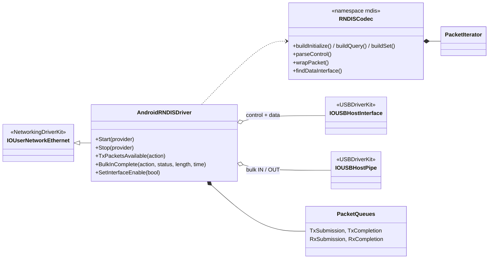
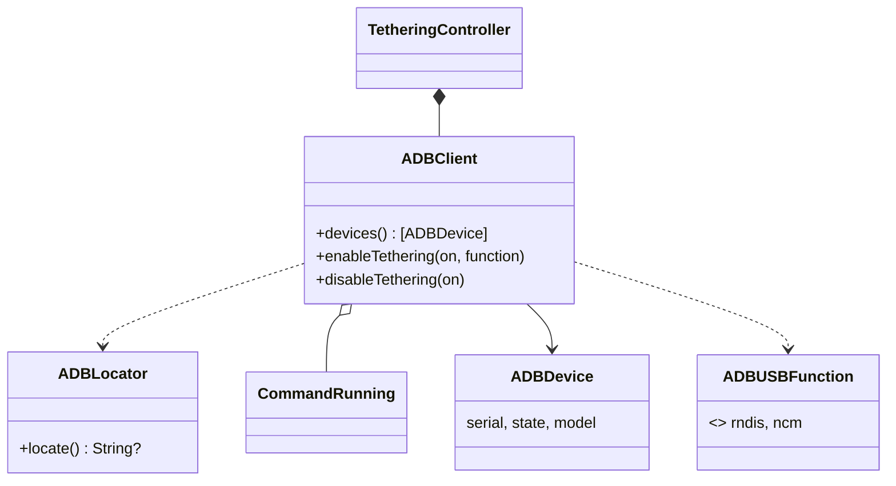
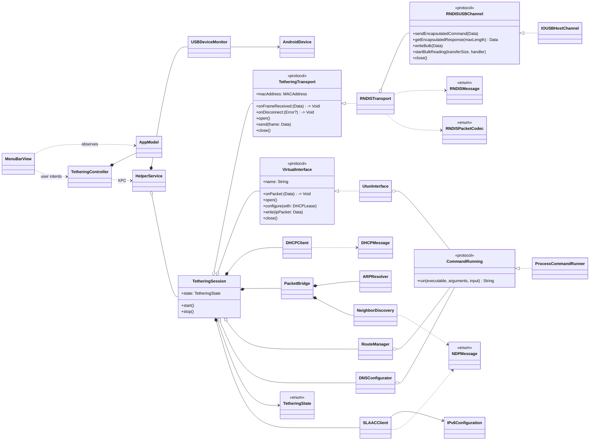

# Architecture

Android USB Tethering is split into four deployable parts that follow **MVC** on the UI side and
**object-oriented, protocol-based design** in the core.

## Two drivers

| | DriverKit driver (`Driver/`) | User-space fallback (`Helper/` + `TetheringCore`) |
|---|---|---|
| Runs as | DriverKit extension (`.dext`), activated with `OSSystemExtensionRequest` | launchd daemon (root), registered with `SMAppService` |
| Network interface | `IOUserNetworkEthernet`, a real `enX` | `utun` (layer 3) |
| DHCP, IPv6, ARP/NDP, DNS, routes | macOS network stack | `DHCPClient`, `SLAACClient`, `ARPResolver`, `NeighborDiscovery`, `RouteManager`, `DNSConfigurator` |
| RNDIS protocol | `rndis::` codec in C++ (`RNDISCodec.cpp`) | `RNDISMessage` / `RNDISTransport` in Swift |
| Entitlements | DriverKit + networking + USB transport (Apple approval) | none |

The DriverKit personality matches the RNDIS interface in the kernel, so the extension claims the
phone first. `HelperService` waits `driverKitGracePeriod` (3 s) after a phone appears. It then asks
`DriverKitDetector` whether an `AndroidRNDISDriver` object is attached below the interface:

- If one is, the helper only reports `.nativeEthernet(deviceName:interfaceName:)`.
- If not, it starts the user-space `TetheringSession`.

### DriverKit driver classes



Driver data path:

```
TX: network stack ─► TxSubmissionQueue ─► rndis::wrapPacket ─► bulk OUT ─► TxCompletionQueue
RX: bulk IN (AsyncIO) ─► rndis::PacketIterator ─► RxSubmissionQueue buffer ─► RxCompletionQueue ─► stack
```

The codec has no DriverKit dependencies, so `Driver/Tests/RNDISCodecTests.cpp` runs on any host.
CI builds and runs those tests on every push.

```
┌─────────────── AndroidUSBTethering.app (user) ───────────────┐
│  Contents/Library/SystemExtensions/…RNDISDriver.dext         │
│  (activated with DriverExtensionManager, OSSystemExtension)  │
│  Model       AppModel, AboutInfo, HelperInstallState,        │
│              DriverInstallState                              │
│  View        MenuBarView, SettingsView, AboutView,           │
│              MenuBarLabel                                    │
│  Controller  TetheringController, HelperConnection,          │
│              HelperInstaller (SMAppService),                 │
│              DriverExtensionManager (SystemExtensions)       │
└──────────────────────────────┬───────────────────────────────┘
                               │ NSXPCConnection (.privileged)
                               │ TetheringHelperProtocol, JSON payloads
┌──────────────────────────────▼───────────────────────────────┐
│  AndroidUSBTetheringHelper (launchd daemon, root)            │
│  HelperService ── USBDeviceMonitor ── TetheringSession       │
└──────────────────────────────┬───────────────────────────────┘
                               │ links
┌──────────────────────────────▼───────────────────────────────┐
│  TetheringCore (Swift package, unit-tested)                  │
└──────────────────────────────────────────────────────────────┘
```

## Turning tethering on with ADB

`ADBClient` (TetheringCore) wraps the `adb` command line tool, which `ADBLocator` finds in Android
Studio's SDK, Homebrew or `$ANDROID_HOME`. It runs in the **app** (user context), not in the root
helper, so the user's existing adb RSA key and the phone's "Allow USB debugging" approval are reused.

```
TetheringController.enableTethering(on:)
  ├─ preferNCM? ── adb shell svc usb setFunctions ncm
  │                 └─ wait ≤ 10 s for HelperStatus.devices to contain an NCM interface
  └─ otherwise / timeout ── adb shell svc usb setFunctions rndis
                              └─ helper (or DriverKit driver) picks up the RNDIS interface
```



## Why a privileged helper?

Opening the phone's USB interfaces, creating a `utun` interface, changing routes and publishing DNS
all require root. The app stays unprivileged; the helper is registered with
`SMAppService.daemon(plistName:)` and only accepts XPC connections from the signed app
(`setCodeSigningRequirement` in release builds).

## Data path

```
 macOS apps ──IPv4/IPv6──► utunN ──► UtunInterface ──► PacketBridge
     ├─ IPv4 ──► ARPResolver ───────┐
     └─ IPv6 ──► NeighborDiscovery ─┴─Ethernet──► RNDISTransport ──PACKET_MSG──► IOUSBHostChannel ──► phone
 phone ──bulk IN──► IOUSBHostChannel ──► RNDISTransport ──Ethernet──► TetheringSession
     ├─ DHCPv4 reply?        ──► DHCPClient
     └─ otherwise            ──► PacketBridge
          ├─ ARP             ──► ARPResolver (learn / reply)
          ├─ NS / NA         ──► NeighborDiscovery (learn / reply)
          ├─ Router Advert.  ──► SLAACClient ──► IPv6Configuration ──► utun address, routes, DNS
          └─ IPv4 / IPv6 data for the host ──► UtunInterface ──► macOS
```

`utun` is a layer-3 interface while RNDIS is layer 2, so `PacketBridge` adds and strips Ethernet
headers and terminates the link-layer protocols itself:

- **IPv4**: DHCP runs in user space before the interface is configured; ARP requests for the host
  address are answered and the phone's MAC is resolved.
- **IPv6**: once IPv4 is up, `SLAACClient` sends Router Solicitations from the EUI-64 link-local
  address. The phone's Router Advertisement provides the /64 prefix, router lifetime and RDNSS DNS
  servers. The global address uses a random interface identifier. `NeighborDiscovery` answers
  Neighbor Solicitations for the host's addresses and resolves next hops. NDP packets are validated
  (hop limit 255, ICMPv6 checksum) and never forwarded to macOS. When the prefix is withdrawn or
  expires, the address, routes and DNS are removed and IPv4 keeps working.

## Class diagram



## Design decisions

| Decision | Rationale |
|---|---|
| `TetheringTransport` / `RNDISUSBChannel` protocols | The RNDIS logic is tested with a mock phone. The IOUSBHost backend can later be replaced by a DriverKit extension without touching the session. |
| `VirtualInterface` protocol | `UtunInterface` is the MVP. A DriverKit `IOUserNetworkEthernet` interface (real `enX`) can replace it. |
| `CommandRunning` for `ifconfig` / `route` / `scutil` | Keeps system side effects injectable and testable. |
| Split default routes (`0/1` + `128/1`, `::/1` + `8000::/1`) | Overrides Wi-Fi without deleting the system default route, so cleanup cannot strand the Mac offline. |
| IPv6 starts after IPv4 and fails independently | Android always provides DHCPv4, but IPv6 only when its upstream has it. An IPv6 problem never takes the connection down. |
| `ARPResolver` / `NeighborDiscovery` share one shape | Same responsibilities (cache, pending queue, reply to solicitations) per address family, which keeps `PacketBridge` symmetric. |
| JSON over XPC | One `@objc` protocol with `Data` payloads. Adding fields to `HelperStatus` does not change the XPC interface. |
| One serial queue per component | The session, helper and DHCP client each serialize their state on a single `DispatchQueue`. |

## Process model

The session lifecycle is modelled in BPMN 2.0 in [`tethering-process.bpmn`](tethering-process.bpmn)
(open it in Camunda Modeler or bpmn.io). `TetheringSession`'s states map to its tasks:

| BPMN element | Code |
|---|---|
| Identify interface class | `USBDeviceMonitor.makeDevice(from:)` |
| Gateway "Tethering protocol?" | `HelperService.deviceAttached(_:)` |
| Gateway "DriverKit extension claimed the phone?" | `HelperService.evaluateRNDISDevice(_:)`, `DriverKitDetector` |
| AndroidRNDISDriver task | `Driver/AndroidRNDISDriver.cpp` → `.nativeEthernet` |
| RNDIS INITIALIZE / Query MAC, set packet filter | `RNDISTransport.open()` → `.initializingLink` |
| DHCP discover / request | `DHCPClient` → `.negotiatingDHCP` |
| Create and configure utun, install routes and DNS | `TetheringSession.configureNetwork(with:)` → `.configuringNetwork` |
| IPv6 SLAAC | `SLAACClient`, `TetheringSession.applyIPv6(_:)` → `ConnectionInfo.ipv6` |
| Connected (catch event) | `.connected(ConnectionInfo)` |
| Link failure boundary event, roll back | `TetheringSession.teardown(finalState: .failed)` |
| Release DHCP, remove routes and DNS, close | `TetheringSession.teardown(finalState: .idle)` |

## Roadmap

1. Validate the DriverKit driver on more phones; move to the newer NDK 22+ queue APIs
   (`registerEthernetInterface`, poller-based queues) when dropping macOS 13.
2. Duplicate Address Detection for the SLAAC address.
3. Optional `adb` integration to switch on tethering from the Mac.
4. Interrupt-endpoint notifications instead of polling `GET_ENCAPSULATED_RESPONSE`.
